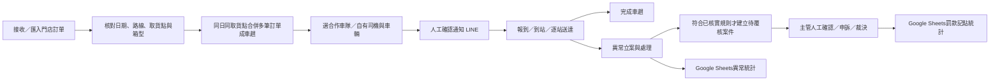
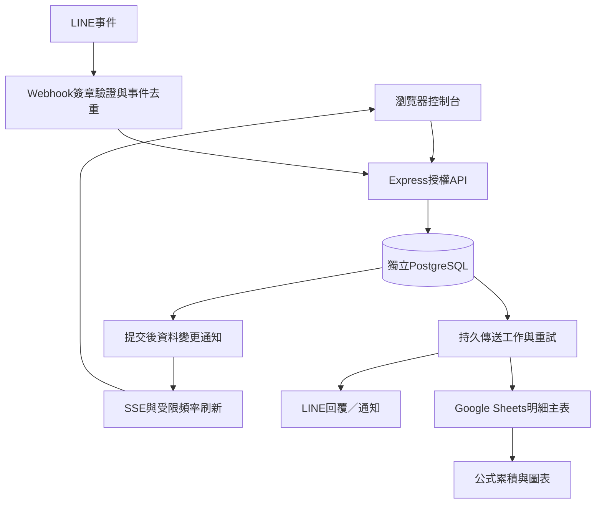

# Wayan 運輸調度中心｜營運架構與介面規格

日期：2026-11-03（台灣時間）。以 way0325-blip/Wayan 現有 Node.js、Express、PostgreSQL 為唯一基礎。這份架構區分已存在功能、本次落地調整及未完成能力，不將展示畫面視為已完成後端。

## 1. 平台定位與設計依據

核心業務是蝦皮店到店配送。營運者先掌握當日待辦，再從訂單、車趟、車隊、異常與人工覆核追查明細。港口作業保留獨立歷史入口，不再當作蝦皮首頁的資料來源。

參考 Microsoft Dynamics 365 的出貨規劃工作台：將訂單行組合成載運工作，分開規劃與執行，並依條件篩選。參考 SAP 的例外工作台：以責任範圍與待處理例外組織工作。以下為依據這些原則、結合本專案現況的設計判斷，未複製其產品或宣稱具備相同商業能力。

- Microsoft 官方：[出貨規劃工作台](https://learn.microsoft.com/en-us/dynamics365/supply-chain/transportation/use-load-planning-workbench-plan-loads-shipments)
- SAP 官方：[例外工作台](https://help.sap.com/docs/SAP_SUPPLY_CHAIN_MANAGEMENT/3834c664fddf4fb99bd5e2f8227be9c9/7edee4672ced4022a66e4f3c9125bac6.html)

## 2. 營運流程與單一入口

| 導覽區 | 模組 | 主要工作 | 完成判準 |
| --- | --- | --- | --- |
| 每日營運 | 營運總覽 | 當日訂單、車趟、報到、待辦與未結異常 | 後端完整彙總；各項數量有日期與單位 |
| 每日營運 | 蝦皮店到店 | 接單、合趟、分派、中文代號、通知、送達 | 保存與派送分開；成功／失敗可追蹤 |
| 每日營運 | 車隊與LINE工作台 | 群組訊息、任務車趟、異常、車隊綁定、雲端同步 | 五個分頁保留既有功能，跨頁同一份資料 |
| 風險與資源 | 異常罰款與規則 | 條款版本、案件、人工覆核、申訴與歷程 | 草稿不可自動計罰，禁止自動扣薪或扣款 |
| 風險與資源 | 司機／車輛／班表 | 基本資料、可用狀態、證照期限、出勤 | 後端檢查派遣衝突與不可用資源 |
| 系統管理 | 後台管理 | 使用者、設定、稽核、蝦皮CSV匯入／日期匯出 | 權限依後端控制，匯入整批交易及回滾 |
| 系統管理 | 司機LINE設定 | 個人綁定、事件與重試 | 私訊本人資料；群組依車隊隔離 |

## 3. 頁面結構

### 營運總覽

1. 頁首：公司名稱、頁面名稱、登入身分、環境標示。
2. 同步列：台灣作業日、即時連線、最近資料時間、更新按鈕、錯誤提示。
3. 八項配送數據：訂單筆數、待安排訂單、有效車趟、待派車趟、執行中、已完成、已報到車次、尚缺報到。
4. 優先處理：待安排、待指派、缺報到、未結異常、待覆核／申訴；點擊前往原管理頁。
5. 取貨點進度與未結異常：五個取貨點完整呈現，舊資料未指定實際取貨點時另計。
6. 今日車趟：最多8筆最近資料預覽；顯示完整總數與全部清單入口。
7. 風險、人工確認金額與點數、Google Sheets儀表板入口、串接設定及傳送狀態。
8. 作業流程說明及折疊的港口歷史資料。

### 蝦皮店到店

共用台灣作業日；「訂單與車趟／報到」及「路線需求／任務派單」沿用同一工作區。手選歷史／未來日期時保留選擇，回到今天才恢復自動跟隨。日期切換不會建立新任務或搬移歷史資料。

### 車隊與LINE工作台

- LINE動態：依綁定群組接收紀錄、Bot回覆與車隊調度側欄。
- 任務與車趟：合作車隊承接進度與蝦皮配送車趟。
- 異常處理：篩選狀態、登記處理結果與歷程。
- 車隊與群組：名冊、群組收錄與經驗證的綁定。
- 雲端同步：管理員檢查Google目標、傳送結果及重送紀錄。

### Google Sheets

既有「Wayan 車隊營運紀錄」增加「異常罰款儀表板」、「罰款項目累積」及隱藏計算工作表。原有明細與分享權限保持不變。包含日期篩選、八項統計、五種異常分類、罰款前10項圖表、車隊累積及157筆規則版本明細。

僅從案件主表的目前狀態累積，歷程表不重複加總；金額和點數須為已確認、覆核人完整且數值有效。申訴中暫停納入已確認總額，撤銷及規則參考金額不納入。最後成功同步時間代表任一明細成功寫入，並非所有佇列已送完。

## 4. 資料層與欄位字典

| 物件 | 既有資料表／欄位 | 定義與關聯 |
| --- | --- | --- |
| 取貨區域 | delivery_warehouses | 原大園、楊梅、觀音三區；保留舊資料 |
| 實際取貨點 | delivery_pickup_points | 大園長榮／水源／大園橘箱；楊梅仁美／威獅黑箱，地址待提供 |
| 門店 | delivery_stores | 門店代碼、名稱、區域、地址、核對狀態及來源 |
| 門店訂單 | delivery_orders | reference為唯一訂單編號；route_code是另一個欄位，不取代訂單或門店代碼 |
| 配送路線類型 | delivery_orders.route_code | N店配、F隔日到貨、W黑箱隔日到貨；不擅自換算日期或金額 |
| 車趟與停靠 | delivery_trips／delivery_trip_stops | 一車趟多訂單；同作業日、同實際取貨點；保留停靠地址與路線快照 |
| 任務需求與承接 | shopee_routes／shopee_assignments | 路線需求車數、分派／確認車數與合作車隊 |
| 自訂任務及報到代號 | task_code／delivery_checkin_aliases | 原車趟編號與每日中文代號分開保存 |
| 報到 | delivery_checkins | 同帳號同車趟只計一次；不同車趟可有各自報到紀錄 |
| 車隊及群組 | partner_fleets／line_fleet_groups | 綁定驗證群組到車隊，未綁定不讀取派單資料 |
| 異常 | fleet_incidents／fleet_incident_history | 種類、嚴重度、責任車隊、處理狀態、回報與歷程 |
| 規則及罰款 | penalty_rules／penalty_cases／penalty_case_history | 規則代碼與版本、核實狀態、主管覆核、人工金額點數、申訴裁決 |
| 串接及稽核 | line_events／fleet_delivery_jobs／fleet_sheet_rows／audit_logs | 事件去重、持久傳送、固定明細列、錯誤及操作歷程 |

## 5. 數據口徑與狀態

| 指標 | 口徑 |
| --- | --- |
| 今日訂單筆數 | delivery_orders.service_date為台灣作業日；包含取消訂單並另列取消數 |
| 有效配送車趟 | 同日且非已取消；完成車趟仍保留於分母 |
| 執行中車趟 | 已派車或配送中 |
| 需求報到 | 當日非取消車趟required_checkins合計 |
| 已報到車次 | 當日非取消車趟的實際delivery_checkins筆數，不是唯一車牌數或總人數 |
| 尚缺報到 | 每趟max(需求－實際報到,0)再合計，不能把超額抵其他缺口 |
| 取貨點完成率 | 該點當日完成趟數／有效趟數；未指定點的舊資料另列 |
| 未結異常與待覆核 | 包含歷史尚未完成案件，不因過午夜消失 |
| 已確認金額／點數 | 目前狀態已確認、覆核人及數值完整；申訴、撤銷、草稿參考金額排除 |
| 模擬資料 | 明確標示包含幾趟模擬資料，不作真實營運績效宣稱 |

- 訂單：待安排 → 已安排 → 配送中 → 已送達；取消依既有後端限制。
- 車趟：待派車 → 已派車 → 配送中 → 已完成；分派不等同車隊已承接。
- 異常：待處理 → 處理中 → 待確認 → 已結案，保留歷程。
- 罰款：待覆核 → 已確認 → 申訴中 → 人工確認或撤銷。
- 同步：待處理／處理中／已送出／失敗／受阻／取消；不把平台保存成功等同外部送達。

## 6. 技術架構與權限

本次沿用GET /api/control/summary並以同一SQL快照增加蝦皮訂單、車趟、報到、取貨點、異常、罰款與傳送統計；無新增資料表、migration或環境變數。首頁每分鐘在可見且無開啟表單時刷新，並沿用SSE及視窗恢復更新。初始數值使用「—」，載入失敗保留錯誤提示，不假裝成功。

管理員可管理權限、規則核實與罰款裁決；調度可接單派車、處理營運與建立待覆核案件。司機與合作車隊目前主要透過已綁定LINE入口使用；不是已完成可任意登入全站的獨立網頁入口。前端不直接操作資料庫；多表寫入、稽核與重要衝突檢查沿用後端交易。

## 7. 版面規格

白色工作區、低彩度藍色主要操作、灰階次要操作；顏色只輔助狀態，並保留文字。桌面固定導覽、四欄配送數據、雙欄進度與異常；平板改兩欄數據、單欄內容；手機導覽縮短、表格在容器內水平捲動。表單焦點、欄位標籤、失敗提示保留。

常用操作放在標題右方，危險／進階管理放入對應分頁；說明採可展開內容。現有欄位ID與操作事件保留，避免只換畫面破壞原功能。清單預覽註明上限，不把前端載入筆數當作完整總量。

## 8. 已完成與下一階段

本次完成：蝦皮首頁資料來源、完整彙總與精確口徑、導航分組、車隊五分頁、亮色版面、異常罰款Google Sheets儀表板與157項累積明細、架構文件。

仍需提供／驗收：五個取貨點地址、個別路線門店與車隊歸屬、真實使用者操作驗收、桌面與手機實際螢幕視覺驗收。Windows視覺工具因無法確認瀏覽器URL停止，未繞過；自動化DOM檢查不等同實機視覺驗收。

尚未建置而不應標為已完成：GPS定位、道路限高限重與路線最佳化、可靠ETA、配送照片／電子簽收、財務應收應付及對帳、正式環境備援與備份還原實演、正式服務等級承諾。隔日到貨分類也不代表已具備自動ETA推算。

正式啟用前應確認：獨立正式與測試身分、資料備份及還原測試、傳送失敗告警、密鑰輪替、Google權限與資料保留。Google儀表板為報表而非主資料庫；目前計算工作表配置10000筆容量，超過時須擴充並驗證公式範圍。

本次工作僅測試分支／既有獨立免費測試服務，不合併PR、不改main、不連正式資料庫、不新增付費資源。

## 9. 本次交付與驗證

新增／修改檔案：public/workspace.js、public/workspace.css、public/control.js、public/index.html、server/operationsSummary.js、server/routes/control.js、server/tests/operations-summary.test.js、scripts/verify-operations-workspace.mjs、docs/WAYAN_OPERATIONS_ARCHITECTURE.md。

API沿用GET /api/control/summary，新增deliveryOrders、deliveryTrips、fleetIncidents、penaltySummary、fleetConnections、deliverySync、pickupActivity、recentDeliveryTrips、recentFleetIncidents與environment欄位；舊欄位仍保留。所有配送卡片使用後端彙總，而非受清單上限影響的前端筆數。無資料表、migration、環境變數或依賴變更。

驗證：lint 98項通過；212項單元／整合通過、0失敗；59項DOM操作通過、0失敗。首次動態DOM有一次fetch失敗，完整DOM重跑通過；未以失敗紀錄冒充成功。Google Sheets驗算涵蓋已確認、待覆核、申訴、撤銷、缺覆核人、0元有效確認，另驗證兩組日期篩選；2004個有效儲存格讀回無公式錯誤，157項規則與兩張圖表存在。驗算暫存工作表已刪除，原營運主表未修改。

視覺驗收限制：Windows Computer Use因無法確認目前瀏覽器URL而停止；未繞過工具限制。CSS響應式規則與DOM功能驗證已完成，但實際桌面及手機螢幕仍需使用者現場驗收。雲端登入後的帳號驗收亦須保留。正式環境與main保持不變；獨立測試分支交付，保留draft PR。
